<div align="center">

# SecShot

**Evidence screenshots for security assessments on macOS.**

Capture, redact, annotate, compare and export screenshots for penetration testing reports,
with the speed of the native macOS screenshot tool and the workflow of a dedicated capture suite.

[](https://github.com/JahazielLem/Secshot/actions/workflows/ci.yml)
[](https://github.com/JahazielLem/Secshot/releases/latest)
[](LICENSE)


[What's new](#whats-new-in-040) ·
[Features](#features) ·
[Installation](#installation) ·
[Usage](#usage) ·
[Security model](#security-model) ·
[Building from source](#building-from-source) ·
[License](#license)

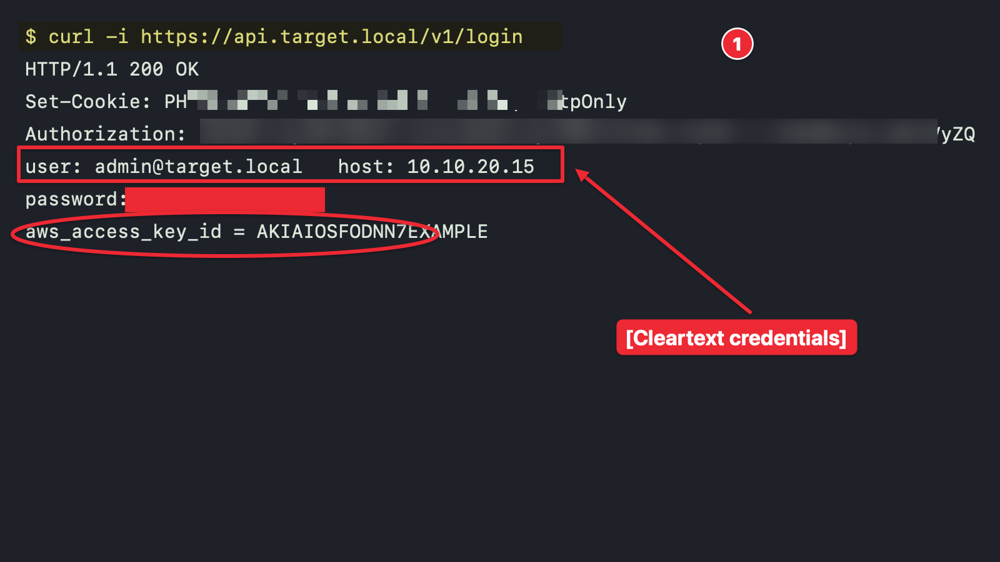

</div>

---

## Why SecShot?

A security assessment produces dozens or hundreds of screenshots. They usually end up on the
Desktop with generic names, contain client secrets in plain sight and have no way to prove they
were not tampered with. SecShot solves that workflow end to end:

- **Consistent evidence naming:** `EVIDENCE-1`, `EVIDENCE-2`, … with no manual renaming.
- **Built-in redaction**, including automatic OCR-based detection of tokens, passwords and keys.
- **Integrity:** every capture is hashed (SHA-256) at capture time, and exports ship with a manifest.
- **Before/after evidence:** side-by-side comparisons, pixel-level diffs and attack-chain timelines.
- **Report-ready output:** macOS-style shadows, metadata-free files, and drag-and-drop into your report.
- **From proxy to report:** import Burp Suite or HAR traffic and turn requests into styled, redacted
  code evidence, comparisons and timelines.

## What's new in 0.4.0

- **Text Capture (OCR)** — press **⌘⇧2** anywhere, select an area and get its text on the clipboard
  as plain text, **Markdown** (tables become Markdown tables) or CSV. Like TextSniper, built for reports.

### 0.3.0

- **HTTP Traffic** — import Burp Suite “Save items” XML, HAR files or raw requests, then create a
  snippet, compare two requests/responses with a diff, or build a timeline. Credentials are redacted
  by default.
- **One main window** with a navigation rail: Library · Compare · Code · Traffic.
- **Code Snippet** (0.2) — syntax highlighting, 12 themes (incl. Catppuccin), VS Code / TextMate theme
  import, HTTP security-header analysis, Compare and Timeline modes, `[REDACTED]` markers and JSON
  pretty-printing.
- **Focus spotlight** and **zoom** editor tools, and an **External Images** tab to compare images
  not taken with SecShot.

See [CHANGELOG.md](CHANGELOG.md) for details.

<p align="center">
  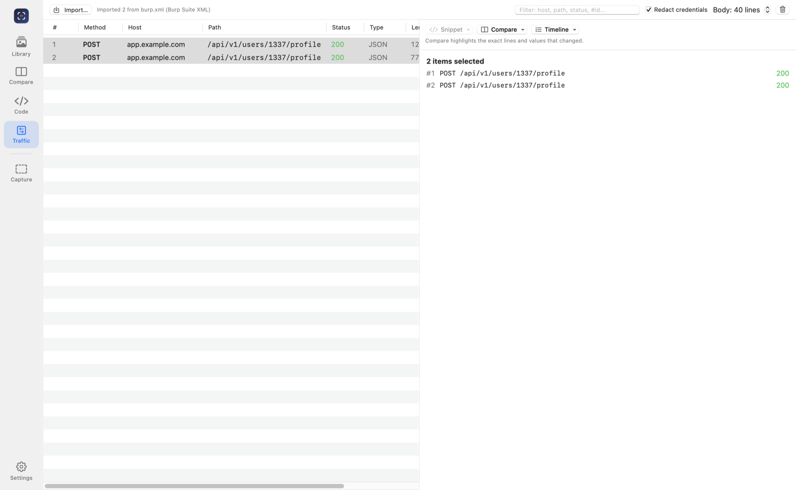
</p>

## Features

SecShot runs as one main window with a navigation rail — **Library**, **Compare**, **Code**,
**Traffic** and **Text** — plus the menu bar icon, the floating capture bar and global hotkeys. Settings and the
per-image editors open in their own windows.

### Capture
| | |
|---|---|
| **Region / Window / Full screen** | Uses the native macOS capture engine, so selection behaves exactly like ⌘⇧4. |
| **Global hotkeys** | ⌃⇧4 region · ⌃⇧5 window · ⌃⇧3 full screen · ⌘⇧2 text (OCR) · ⌃⇧2 toggle capture bar · ⌃⇧6 / ⌃⇧7 / ⌃⇧8 open Code, Compare, Traffic. |
| **Floating capture bar** | A ⌘⇧5-style toolbar that docks to any screen edge or floats anywhere, and can be turned on and off. |
| **Timer** | 5 s and 10 s delays to capture menus and hover states. |
| **Menu bar icon** | Every capture action is one click away. |

### Library
- History grouped by day, with search across names and report notes.
- **Naming convention**: set a prefix (e.g. `EVIDENCE-`, `FINDING-`) and each new capture is numbered automatically. Every prefix keeps its own counter, with optional zero padding (`001`).
- Rename, apply the convention to a selection in chronological order, import images, move to Trash.
- Drag any capture straight into Word, Pages, Dradis, etc. The final rendered image is exported on the fly.

### Editor (non-destructive)
- Rectangle, ellipse, arrow, line, text and callouts, highlighter, numbered steps, and crop.
- **Focus spotlight**: dims and blurs everything around an ellipse or rectangle to draw the reader's eye to one area.
- **Zoom / magnifier**: enlarges a region into a callout with connector lines. *Pixel-perfect* mode enlarges every pixel exactly, so screenshot text stays sharp; *Smooth* mode uses Lanczos resampling.
- Move and delete annotations, unlimited undo/redo, and single-key tool shortcuts.
- The original PNG is never modified. Edits are stored separately and flattened on export.

### Security-focused tooling
- **Solid redaction**, **pixelation** and **hardened blur** (pixelates before blurring, so the text cannot be recovered by deblurring).
- **Automatic sensitive-data detection** with on-device OCR (Apple Vision): JWTs, AWS access keys, passwords/tokens/API keys, session cookies, long hex and Base64 secrets, private keys, emails, IPv4/MAC addresses and payment cards. You can choose which categories are detected.
- **Metadata stripping:** exports are re-encoded without EXIF, GPS or author data.
- **Chain of custody:** SHA-256 of every original capture, plus an `evidence-manifest.csv` and `evidence-report.md` on batch export.

<p align="center">
  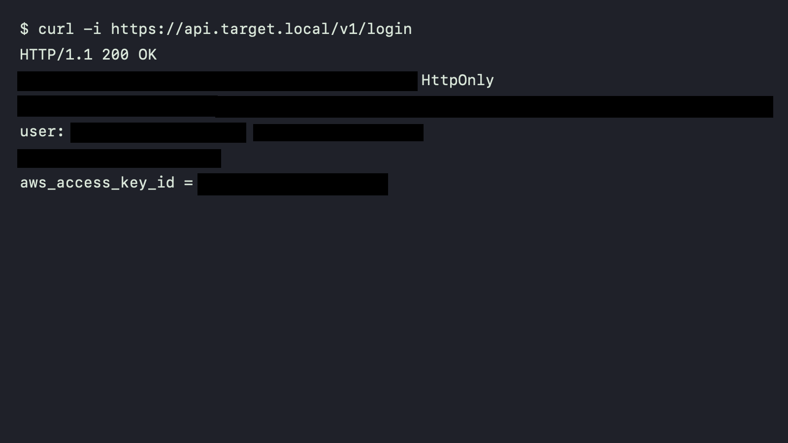
</p>

### Comparison & timeline
- Choose a **BASE** and a **CHANGE** capture, or capture straight into either slot.
- Layouts: **side by side**, **stacked**, **highlighted differences** (pixel diff with boxed regions and a change percentage) and an interactive **before/after slider**.
- **Timeline** mode chains N captures into a numbered, timestamped attack narrative.
- Results are saved back to the library as new evidence, following the naming convention.
- **External Images** tab: drop or choose any images (not taken with SecShot), edit them with the full editor, and build comparisons or timelines from them. They stay out of your evidence library until you save the result or add an image explicitly.

<p align="center">
  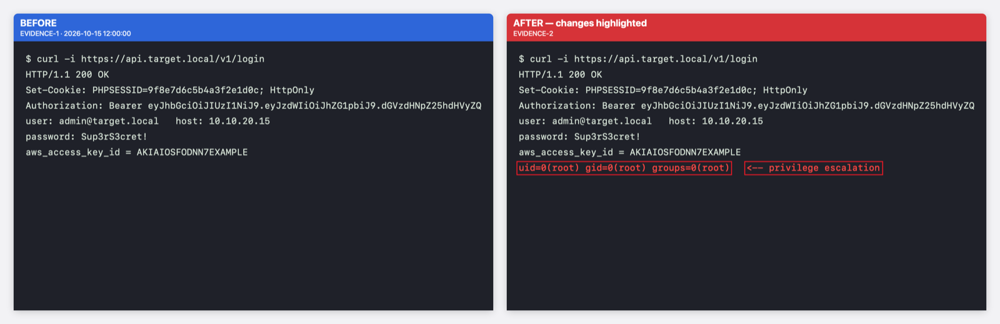
</p>

<p align="center">
  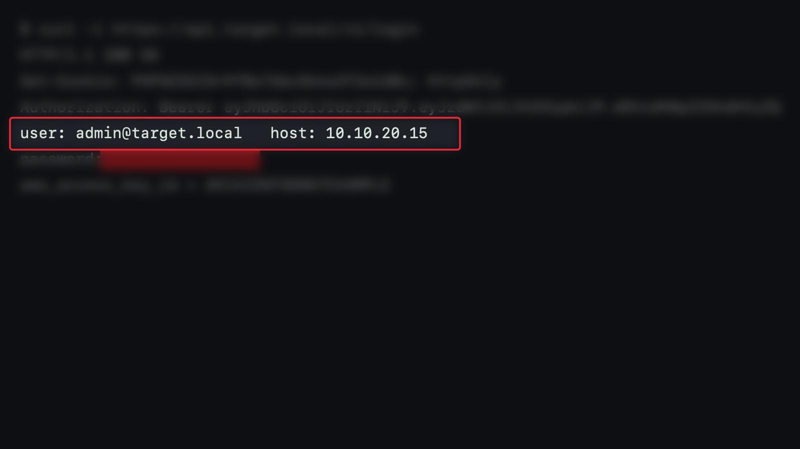
  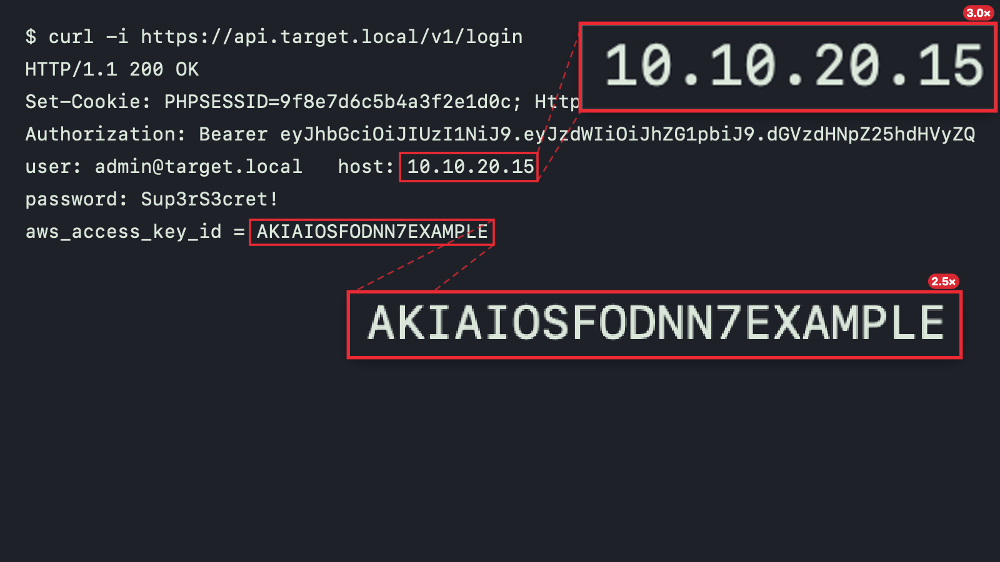
</p>

<details>
<summary><b>More examples</b>: timeline, slider and macOS shadow</summary>
<br>
<p align="center">
  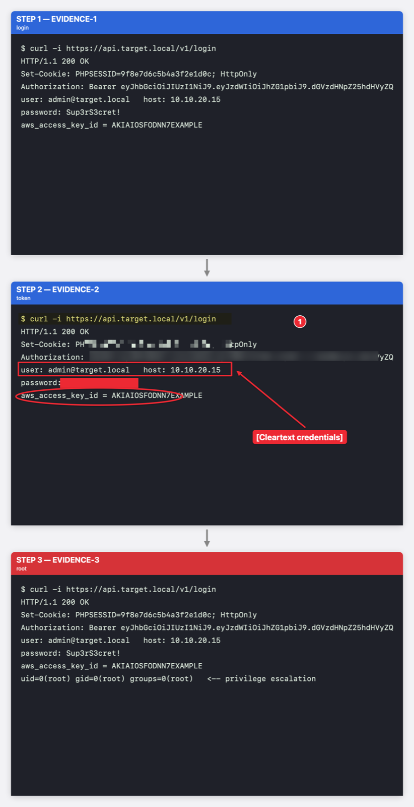
  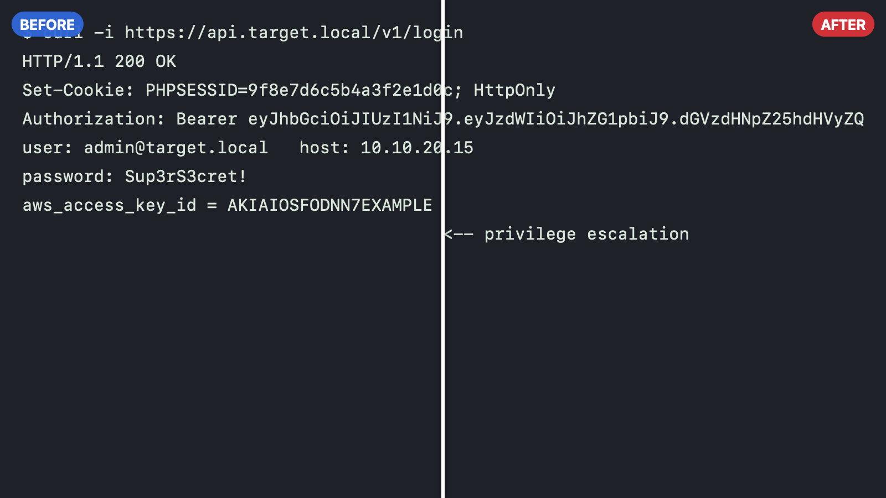
  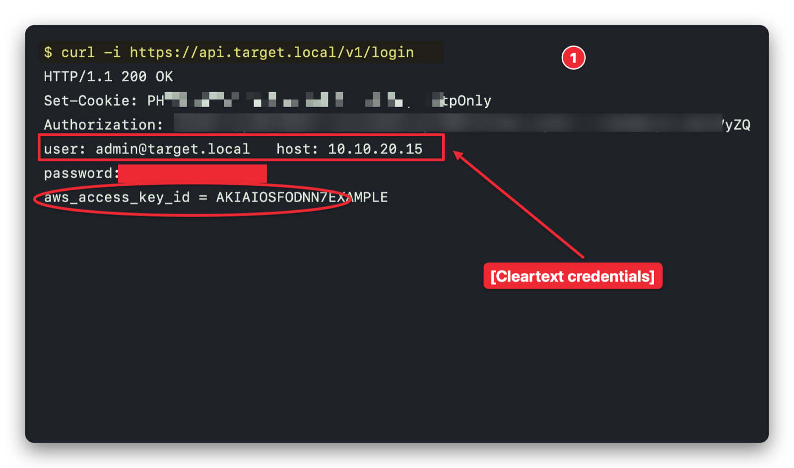
</p>
</details>

### Code snippets
Turn code, terminal sessions and raw HTTP traffic into clean, styled images (⌘4).
- **Syntax highlighting** for HTTP requests/responses, JSON, shell sessions (prompts, commands, flags and output are told apart), Python, JavaScript/TypeScript, C-like languages, SQL and XML/HTML, with auto-detection.
- **Styles**: 12 built-in themes (Terminal, Hacker Green, Dracula, One Dark, Monokai, Nord, Solarized Dark, GitHub Light and the four Catppuccin flavors: Latte, Frappé, Macchiato, Mocha), 4 window frames (macOS window, terminal, background only, no frame) and gradient, solid or transparent backgrounds.
- **HTTP security-header analysis**: each header gets a marker (good / weak / informational), and a summary lists issues such as Report-Only or `unsafe-inline` CSPs, short HSTS `max-age`, cookies without `Secure`/`HttpOnly`/`SameSite`, wildcard CORS, software disclosure and missing recommended headers.
- **Compare** two snippets (e.g. original vs. tampered request) with a line diff: removed lines in red, added lines in green, and the exact changed fragment emphasized (`role=user` → `role=admin`).
- **Timeline** mode chains N snippets into a numbered attack narrative. Arrows between snippets are optional in both modes.
- **Redact** (⇧⌘R or right-click) replaces the selected text with a marker such as `[REDACTED]`, configurable in *Settings → Security* or from the window. The marker is highlighted in red in the image, and redacted credentials are no longer flagged by the header analysis.
- **Themes you can bring and tweak**: import VS Code (`.json`, comments allowed) or TextMate (`.tmTheme`) themes, customize any color with a live preview, and export them as JSON. Custom themes live in `~/Library/Application Support/SecShot/Themes`.
- **Format JSON**: minified JSON documents and HTTP bodies are indented (key order and values are preserved), so diffs point at the exact field that changed.
- Line numbers, highlighted lines, wrapping that keeps header values aligned, and a window title.
- Saved snippets become regular evidence, so you can redact, annotate, spotlight or zoom them. Pasted code is never written to disk unless you save the image.

<p align="center">
  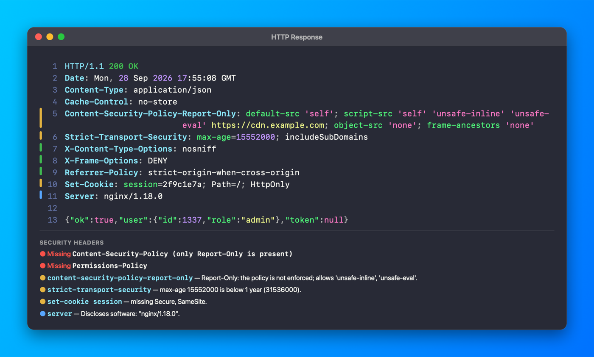
  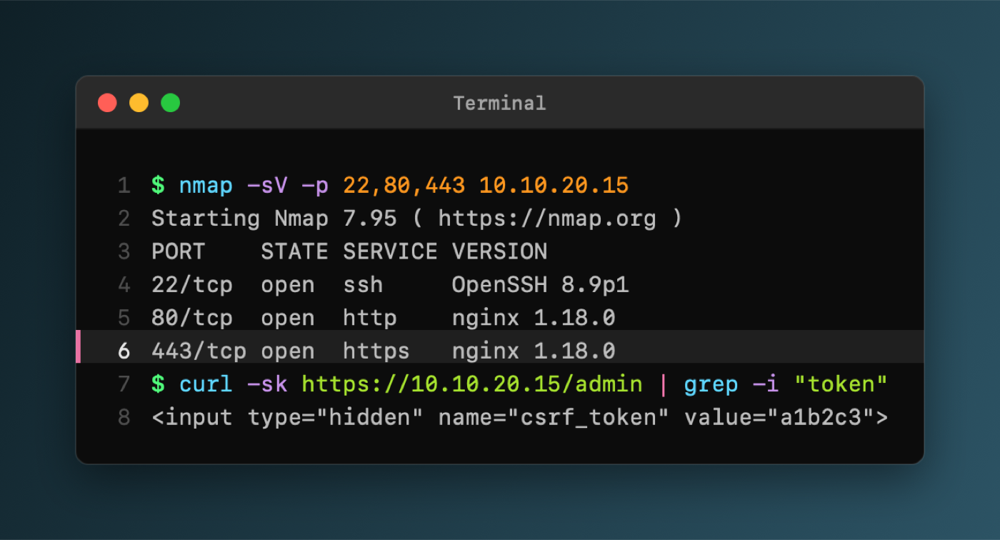
</p>
<p align="center">
  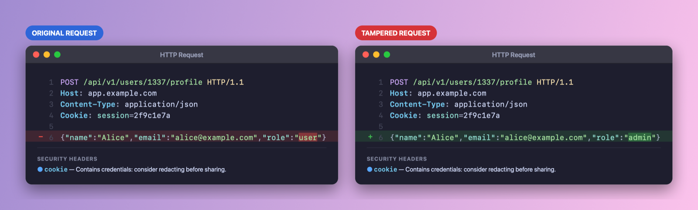
</p>

<details>
<summary><b>Code timeline example</b></summary>
<p align="center">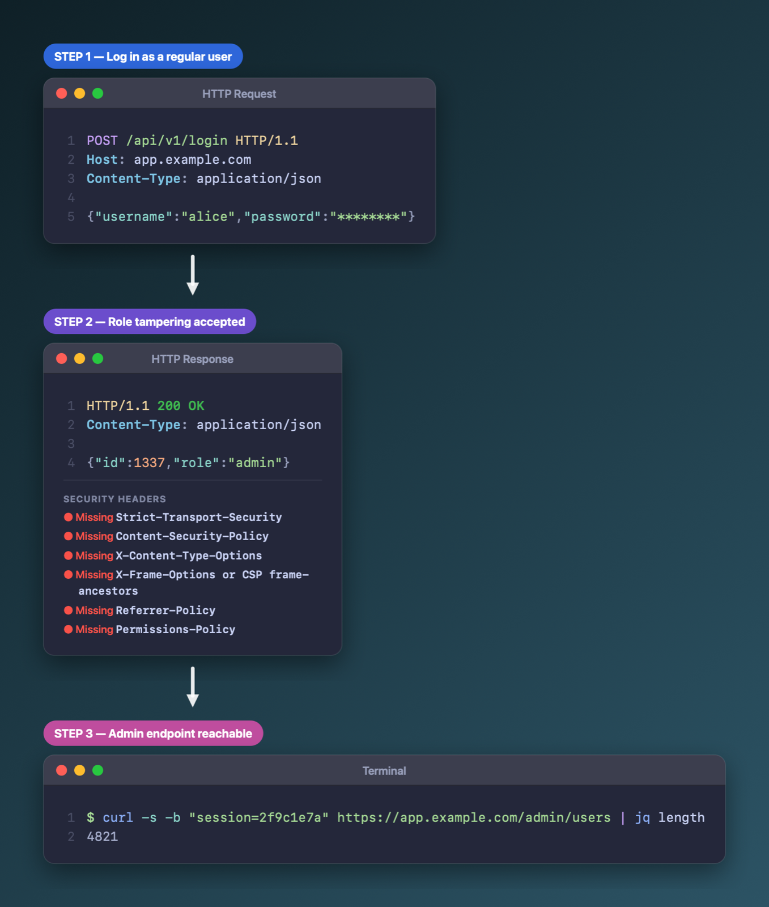</p>
</details>

<details>
<summary><b>Theme file format</b></summary>

```json
{
  "name": "My Theme",
  "type": "dark",
  "colors": {
    "background": "#1E1E2E", "foreground": "#CDD6F4", "comment": "#6C7086",
    "keyword": "#CBA6F7", "string": "#A6E3A1", "number": "#FAB387",
    "function": "#89B4FA", "type": "#F9E2AF", "attribute": "#94E2D5",
    "variable": "#F38BA8", "headerName": "#74C7EC", "prompt": "#A6E3A1",
    "output": "#A6ADC8", "lineNumber": "#45475A"
  }
}
```
</details>

### HTTP traffic (Burp Suite, HAR)
Import the requests you used during the test and turn them into evidence (⌘5, ⇧⌘I).
- **Burp Suite**: in Proxy › HTTP history (or Repeater/Logger) select the requests → right-click →
  **Save items** to get the XML export. **HAR** files from browser DevTools, Caido or ZAP and raw
  `.txt`/`.http` requests or responses are supported too. Burp `.burp` project files are not (closed format).
- Select **1** item for a snippet (request, response, or both side by side), **2** to compare their
  requests or responses with a line diff, or **several** for a timeline.
- Credentials are **redacted by default** (cookies, `Authorization`, API keys, password/token fields),
  JSON bodies are pretty-printed, and long bodies are limited to a configurable number of lines.
- Imported traffic stays in memory only, and XML is parsed with external entities disabled.

### Text capture (OCR)
Copy text from anything on screen — a PDF table, a terminal in a VM, a scanner report, a video call.
- **⌘⇧2** from any app: select an area and the text is copied to the clipboard in your default format.
- **Plain text** keeps line breaks; table columns are separated by tabs, so they paste as columns in
  Excel or Numbers.
- **Markdown** detects tables (aligned columns become `| … |` tables with a header row), bullet and
  numbered lists, and headings (larger text).
- **CSV** for spreadsheets.
- The **Text** section (⌘6) shows the detected text over the image, lets you switch format, edit and
  re-copy, recognize an image file or a clipboard image, and keeps recent captures in memory.
- Recognition runs on-device with Apple Vision; the captured image is not saved unless you add it to
  the library. Turn off *language correction* in Settings for code, hashes and tokens.
- If no text is found, only a notice is shown: nothing is copied or kept.

### Copy to clipboard
Each capture type has its own switch in *Settings → Copy to Clipboard* — region, window, full screen,
comparison/timeline captures and text capture. When enabled, the result goes straight to the
clipboard (images for screenshots, text for ⌘⇧2); captures are still saved to the library as usual.

<p align="center">
  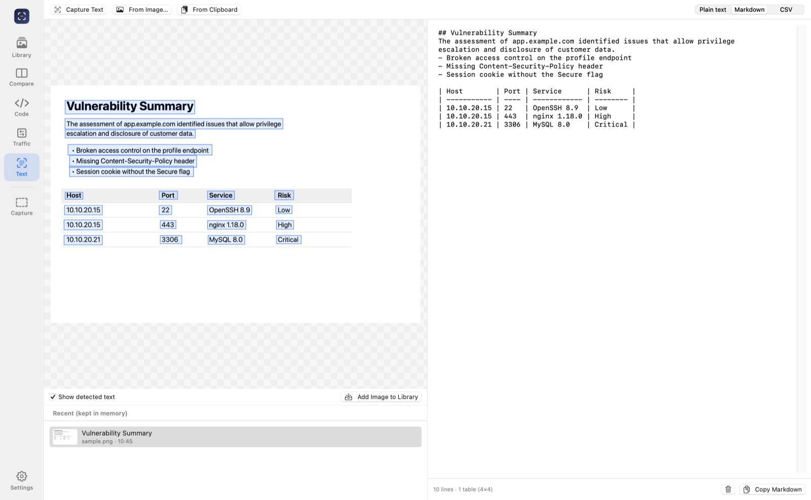
</p>

### Output
- macOS-style window shadow and rounded corners, which you can toggle; transparent or white background.
- PNG or JPEG, optional 144 DPI tagging so Retina captures paste at the right size.
- Copy to clipboard, export a single image, or batch export with manifest.

> The images above were generated by SecShot's own rendering engine (`--selftest`) using fake data.

## Installation

### Download (recommended)

1. Download the latest **`SecShot-x.y.z.dmg`** from the [Releases page](https://github.com/JahazielLem/Secshot/releases/latest).
2. Open the DMG and drag **SecShot** into **Applications**.
3. Launch SecShot. macOS will ask for **Screen Recording** permission:
   *System Settings → Privacy & Security → Screen Recording → enable SecShot*, then relaunch the app.

> [!IMPORTANT]
> Builds that are not notarized by Apple are blocked by Gatekeeper on first launch.
> Open *System Settings → Privacy & Security* and click **Open Anyway**, or run:
> ```bash
> xattr -dr com.apple.quarantine /Applications/SecShot.app
> ```

**Verify the download** using the `SHA256SUMS.txt` file published with each release:

```bash
shasum -a 256 -c SHA256SUMS.txt
```

### Requirements

- macOS 14 Sonoma or later
- Apple Silicon or Intel

## Usage

### Global hotkeys (work from any app)

| Shortcut | Action |
|---|---|
| ⌃⇧4 | Capture a region |
| ⌃⇧5 | Capture a window / app |
| ⌃⇧3 | Capture the full screen |
| ⌘⇧2 | Capture text (OCR) and copy it |
| ⌃⇧2 | Show / hide the floating capture bar |
| ⌃⇧6 | Open Code Snippet |
| ⌃⇧7 | Open Compare & Timeline |
| ⌃⇧8 | Open HTTP Traffic |

### Main window

| Shortcut | Action |
|---|---|
| ⌘1 | Library |
| ⌘2 | Compare & Timeline |
| ⌘3 | Compare external images |
| ⌘4 | Code Snippet |
| ⌘5 | HTTP Traffic |
| ⌘6 | Text Capture |
| ⇧⌘I | Import HTTP traffic (Burp XML, HAR) |
| ⌘O | Import images into the library |
| ⌘, | Settings |

### Editor shortcuts

| Key | Tool | Key | Tool |
|---|---|---|---|
| `V` | Select / move | `N` | Numbered step |
| `R` | Rectangle | `P` | Pixelate |
| `A` | Arrow | `B` | Hardened blur |
| `T` | Text | `X` | Solid redaction |
| `H` | Highlighter | `C` | Crop |
| `S` | Focus spotlight | `Z` | Zoom / magnifier |
| `⌫` | Delete selection | `⌘Z` / `⇧⌘Z` | Undo / Redo |

`⌘E` exports and `⇧⌘C` copies the final image.

### Code Snippet shortcuts

| Shortcut | Action |
|---|---|
| ⌥⌘1 / ⌥⌘2 / ⌥⌘3 | Single / Compare / Timeline mode |
| ⇧⌘R | Redact the selected text (also in the right-click menu) |
| ⇧⌘C | Copy the image to the clipboard |
| ⌘E | Export the image |
| ⌘S | Save as evidence |

### Typical workflow

1. Set your prefix in the sidebar (for example `EVIDENCE-`).
2. Capture with a hotkey or the capture bar; the editor opens on the new capture.
3. Click **Detect & Redact Sensitive Data**, review the result, and add arrows, callouts and notes.
4. For a change you exploited, open **Compare**, capture the BASE and the CHANGE, and save the diff.
5. For web findings, export the requests from Burp (**Save items**), import them in **Traffic** (⇧⌘I),
   select the original and the tampered request and choose **Compare › Compare Requests**. Review the
   redaction in **Code** and save it as evidence (⌘S).
6. Select the evidence and choose **Export with Manifest…** to get the images, the CSV manifest and a Markdown report.

### Launch at login

Enable *Settings → General → Open SecShot at login*. At login, SecShot starts in the background
with only the capture bar (if enabled), the menu bar icon and the hotkeys, and no windows. Click
its Dock icon to open the library.

## Security model

- **Everything stays local.** SecShot makes no network connections. Captures live in
  `~/Pictures/SecShot` alongside a `library.json` index.
- **Untrusted input is handled defensively.** Burp XML is parsed with external entities disabled
  (no XXE), files over 300 MB are refused, and imported traffic and pasted code are kept in memory
  only, never written to disk unless you save an image.
- **Originals are preserved.** The unedited PNG and its SHA-256 are kept for chain of custody, and
  exports are always flattened, so no redacted pixels survive in layers.
- **Choose the right redaction.** Pixelation and blur reduce legibility; for passwords, tokens and
  private keys use **solid redaction**, which is irreversible.
- **Review automatic redaction.** OCR-based detection is a safety net, not a guarantee. Always
  review the output before sharing it.
- The capture bar is excluded from screenshots and hidden while a capture is in progress.

## Building from source

Only the **Xcode Command Line Tools** are required; the full Xcode app is not needed.

```bash
git clone https://github.com/JahazielLem/Secshot.git
```

```bash
cd Secshot && ./build.sh
```

The app is written to `build/SecShot.app`.

### Install locally as a regular app

```bash
scripts/create-signing-cert.sh
```

```bash
scripts/install.sh
```

`create-signing-cert.sh` runs once. It creates a local code-signing identity so macOS keeps the
Screen Recording permission across rebuilds (ad-hoc signatures lose it every time).
`install.sh` builds, copies the app to `/Applications` and registers it with Launchpad and Spotlight.

### Build options

| Variable | Default | Description |
|---|---|---|
| `VERSION` | `0.3.0` | App version |
| `BUILD_NUMBER` | `1` | Build number |
| `UNIVERSAL` | `0` | `1` builds a universal arm64 + x86_64 binary (requires Xcode) |
| `SIGN_IDENTITY` | auto | Signing identity; `Developer ID Application: …` enables hardened runtime and notarization |

### Self-test

```bash
build/SecShot.app/Contents/MacOS/SecShot --selftest /tmp/secshot-selftest
```

Renders sample annotations, decorations, diffs, timelines, code snippets and automatic redaction
without needing screen access. CI runs it on every push.

### Command-line helpers

| Command | Purpose |
|---|---|
| `--codeshot <in> <out.png> [theme] [frame] [background]` | Render a code snippet (theme can be a name or a theme file) |
| `--codecompare <before> <after> <out.png> [theme]` | Before/after diff of two snippets |
| `--codetimeline <out.png> <step files…>` | Numbered timeline of snippets |
| `--traffic <burp.xml\|file.har\|request.txt> [a b out.png]` | List imported items; optionally compare two requests |
| `--ocr <image> [plain\|markdown\|csv]` | Recognize the text in an image and print it in the given format |
| `--permission-status <file>` / `--login-status <file>` | Diagnostics (run through `open -a SecShot --args …`) |

Run them with `/Applications/SecShot.app/Contents/MacOS/SecShot`.

### Project layout

```
Sources/SecShot/
├── SecShotApp.swift        App entry point, menu bar item, commands
├── CaptureBar.swift        Floating ⌘⇧5-style capture bar
├── CaptureService.swift    Region / window / full-screen capture
├── LibraryStore.swift      Persistence, history and naming convention
├── Renderer.swift          Flattening, redaction, shadow, composites, diff
├── SensitiveDetector.swift OCR + secret patterns
├── CodeHighlighter.swift   Syntax highlighting for code, shell and HTTP
├── CodeShot.swift          Code themes, header analysis and renderer
├── CodeCompare.swift       Code diff, comparison and timeline
├── CodeThemeLibrary.swift  Custom / imported themes
├── HTTPTraffic.swift       Burp XML / HAR / raw HTTP import, redaction, formatting
├── JSONFormatter.swift     Order-preserving JSON pretty-printer
├── TextRecognizer.swift    OCR (Vision) and layout → plain text / Markdown / CSV
├── TextCapture.swift       ⌘⇧2 text capture flow and recent captures
├── ToastHUD.swift          Non-activating "copied" notice
├── ExportService.swift     Metadata-free export, clipboard, manifest
├── HotKeys.swift           Global hotkeys (Carbon)
├── LoginItem.swift         Background launch at login
└── Views/                  Main window (navigation rail), library, editor, comparison,
                            code, traffic and settings UI
```

See [docs/DESIGN.md](docs/DESIGN.md) for the design rationale and roadmap.

## Releasing

Releases are built by GitHub Actions ([`release.yml`](.github/workflows/release.yml)) when a
version tag is pushed:

```bash
git tag v1.0.0 && git push origin v1.0.0
```

The workflow builds a universal binary, runs the self-test, packages a DMG and a ZIP with
SHA-256 checksums and publishes the GitHub release. Third-party actions are pinned by commit,
and signing secrets only ever exist in a temporary keychain that is deleted afterwards.

Release builds can be signed at three levels:

| Level | Gatekeeper on first launch | Screen Recording permission after updating | Cost |
|---|---|---|---|
| Ad-hoc (no secrets) | Warning | **Lost on every update** | Free |
| Stable self-signed certificate | Warning | **Kept** | Free |
| Developer ID + notarization | No warning | Kept | Apple Developer Program |

**Stable self-signed certificate (recommended without a paid account).** Generate it once and
store it as repository secrets:

```bash
scripts/create-release-cert.sh
```

The script prints the values for `MACOS_CERT_P12`, `MACOS_CERT_PASSWORD` and
`MACOS_SIGN_IDENTITY`. Every release is then signed with the same certificate, so macOS keeps the
permission across updates. Back up the generated `.p12`: if you lose it, users have to grant the
permission once more.

**Developer ID.** To ship builds that install without Gatekeeper warnings, set these secrets
instead. An [Apple Developer Program](https://developer.apple.com/programs/) membership is required:

| Secret | Value |
|---|---|
| `MACOS_CERT_P12` | *Developer ID Application* certificate and private key as a base64 `.p12` (`base64 -i cert.p12 \| pbcopy`) |
| `MACOS_CERT_PASSWORD` | Password of the `.p12` |
| `MACOS_SIGN_IDENTITY` | e.g. `Developer ID Application: Your Name (TEAMID)` |
| `APPLE_ID` | Apple ID of the developer account |
| `APPLE_TEAM_ID` | 10-character Team ID |
| `APPLE_APP_PASSWORD` | App-specific password from appleid.apple.com |

Without any secrets the release is still published, but it is ad-hoc signed.

## Troubleshooting

**SecShot keeps asking for Screen Recording permission even though it is enabled.**
macOS ties the permission to the app's code signature. If SecShot was replaced by a build with a
different signature (for example an ad-hoc build replaced by a signed one), System Settings still
shows it as enabled, but that entry no longer matches. To fix it:

1. Click **Repair Permission** in the alert (or in *Settings → Permissions*).
2. Enable SecShot again in *System Settings → Privacy & Security → Screen Recording*.
3. Choose **Quit & Reopen**.

The manual equivalent is:

```bash
tccutil reset ScreenCapture local.secshot.app
```

Using a stable signature (see [Releasing](#releasing)) prevents this from happening on updates.

**SecShot does not open at login.** Earlier versions used a background login agent that macOS
refuses to start unless the app is signed with an Apple Team ID ("Launch Constraint Violation" in
crash reports). Current versions migrate automatically: open SecShot once and check that
*Settings → General → Open SecShot at login* is on.

**Captures only show the wallpaper.** This is the same cause: the permission is not active for
the running build. Follow the steps above.

## Roadmap

Planned ideas — finding templates with CVSS, reporting-platform integrations, copy as `curl`,
automatic redaction inside code, retest mode and more — are tracked in [ROADMAP.md](ROADMAP.md).
See [CHANGELOG.md](CHANGELOG.md) for what changed in each version.

## Contributing

Issues and pull requests are welcome. Please run `./build.sh` and the self-test before opening a
pull request, and keep all user-facing text in English.

## License

SecShot is free software: you can redistribute it and/or modify it under the terms of the
**GNU General Public License v3.0 or later**. See [LICENSE](LICENSE) for the full text.

This project was developed with AI assistance; source files carry a `Made by AI` notice.
